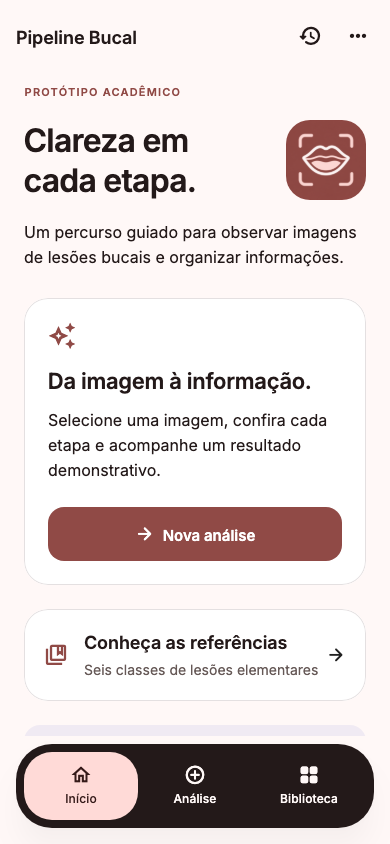
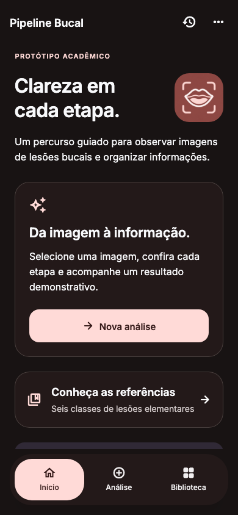

# Entrega de UX e design — Pipeline Bucal 0.3.0+4

Verificação inicial em 29/10/2026, atualizada com a instalação Android em 30/10/2026. Esta entrega demonstra circulação de imagens e informações; não implementa IA clínica, diagnóstico ou retreinamento. Os documentos acadêmicos originais e `src/pipeline/` foram preservados.

## Recursos implementados

- Identidade própria baseada nas 30 cores do SVG fornecido, com temas claro/escuro completos, Inter embarcada, tokens reutilizáveis e novo ícone iOS/Android.
- Home, menu inferior flutuante Início/Análise/Biblioteca, configurações, informações e histórico. Alternar abas preserva a análise em andamento.
- Aquisição por câmera, galeria ou referência local, prévia e confirmação explícita antes de enviar à cloud.
- Recorte automático simulado e edição sobre a imagem original, com movimento, alças, zoom e controles acessíveis. Os pixels corrigidos seguem pelas etapas seguintes.
- Recuperação de detecção ausente e qualidade inadequada; nova imagem reinicia a detecção e invalida resultados dependentes.
- Seis classes, referências documentadas, concordância, seleção alternativa e incerteza. A incerteza continua usando a classe original provisoriamente, sem virar concordância; o aviso acompanha o resultado.
- Seis questionários demonstrativos em seções, revisão e edição, ligados a seis componentes multimodais separados.
- Risco baixo, médio ou alto, sem porcentagens, sempre simulado e acompanhado de orientação para avaliação médica.
- Sorteio independente por análise no uso normal cloud/offline; quinze cenários determinísticos separados para demonstração. Retry não sorteia outro resultado para a mesma operação.
- Eventos, tempo ativo, retornos, feedback, conclusão/abandono e sessões anteriores em memória. Exportação JSON manual sem imagens ou nomes de pacientes; origem preservada por sessão.
- Invalidação de resultados dependentes e descarte de respostas assíncronas obsoletas.

## Organização dos entregáveis

| Entregável | Local no repositório |
| --- | --- |
| Primitivos, semântica e temas JSON | `design/tokens/` |
| Paleta original preservada | `design/sources/` |
| Tema e componentes Flutter | `mobile/lib/design_system/` |
| Modelos, contratos, transporte e eventos | `mobile/lib/core/` |
| Controlador e telas | `mobile/lib/features/analysis/` |
| Menu, home, configurações e histórico | `mobile/lib/features/app/` |
| Biblioteca e cenários | `mobile/lib/features/library/`, `mobile/lib/features/demo/` |
| Arte do ícone e exportação dos launchers | `design/branding/` |
| Fotografias, origens e extrator verificável | `design/reference_library/` |
| Mockups SVG, pranchas e protótipo visual | `design/figma/` |
| API v2 e seis módulos fantasmas | `cloud/` |
| Testes Flutter | `mobile/test/` |
| Capturas da implementação | `docs/ux/screenshots/flutter/` |
| Protocolo futuro com profissionais | `docs/ux/validation/PROTOCOL.md` |

O design system e suas variantes estão descritos em [DESIGN_SYSTEM.md](DESIGN_SYSTEM.md). O mapa de estados e as regras de invalidação estão em [ARCHITECTURE.md](ARCHITECTURE.md).

## Mockups e Figma

[Arquivo dedicado no Figma](https://www.figma.com/design/hzwZXkdUf8RE0bY45KAWbx): criado, **sem conteúdo nativo**, porque a integração informou que a cota de chamadas do plano Starter foi atingida antes da construção da biblioteca. Nenhum upgrade foi contratado.

A alternativa prevista no pedido está entregue: **72 SVGs editáveis (36 estados nos dois temas), seis pranchas, protótipo HTML com quinze cenários e 34 prévias PNG**. Os SVGs contêm texto e elementos vetoriais editáveis, mas não equivalem a componentes Figma nativos com Auto Layout/variantes. As conexões navegáveis estão no HTML; importar SVGs não transfere essas conexões automaticamente.

Abra `design/figma/prototype.html`, ou sirva o repositório com `python3 -m http.server 8768` e visite `http://localhost:8768/design/figma/prototype.html`. Instruções completas em `design/figma/README.md`.

Os estados incluem os 28 solicitados — início, aquisição, prévia, detecção, validação/editor, falhas, reenvio, foco, classificação/referências, concordância, discordância, alternativa, incerteza, questionário, revisão, processamento, três riscos, classe não confirmada, conclusão, informações e recuperação — e oito estados adicionais de biblioteca, histórico e revisão. A verificação estrutural encontrou 506 ações e nenhum destino quebrado.

Os quatro links Mobbin foram tentados, mas as telas não ficaram acessíveis. A captura específica do menu também não foi recuperada. A solução segue a descrição de menu flutuante fornecida pela usuária; não afirma ter reproduzido capturas não visualizadas.

## Executar o Flutter

```sh
cd mobile
flutter pub get
flutter analyze
flutter test
flutter run -d <dispositivo>
```

Ambiente validado: Flutter 3.41.7 / Dart 3.11.5. Instruções de assinatura, execução e integração em [mobile/README.md](../../mobile/README.md).

Modo de demonstração: **⋯ → Sobre e configurações → Painel de demonstração**. Escolha o cenário antes de iniciar a análise. O fluxo normal utiliza Cloud Run; offline é escolha explícita, sem fallback silencioso. O botão de relógio abre o histórico e sua exportação.

## Cloud publicada e verificada

Revisão **`pipeline-bucal-00003-kx2`**, 100% do tráfego, no serviço existente. A API v1 permanece compatível e a v2 atende à nova interface. Endpoint usado na verificação:

`https://pipeline-bucal-qpkmvmtgra-uc.a.run.app`

O teste HTTPS passou por 19 chamadas com imagens sintéticas: saúde v1/v2, cinco etapas, recorte manual, falha de detecção, três decisões, três riscos, feedback e retry. Não foram enviados exemplos clínicos dos artigos durante esses testes.

Conta observada em avaliação gratuita, sem upgrade de faturamento. A restrição de custo financeiro zero permanece; limites técnicos de instâncias não equivalem a um teto financeiro.

Contrato definitivo e registro de publicação: `cloud/CONTRACT_V2.md` e `cloud/README.md`.

## Resultados da validação

| Verificação | Resultado |
| --- | --- |
| Suíte Flutter final, incluindo Python real | **71 testes passaram, 0 omitidos** |
| Análise estática Flutter global | Sem problemas |
| Backend Python v1/v2 | **21 testes passaram** |
| Smoke HTTPS publicado | Passou, incluindo baixo/médio/alto risco |
| Contrastes dos tokens | 28 pares aprovados |
| Mockups SVG e navegação | 72 telas, 506 ações, 0 destinos quebrados |
| Layouts de acessibilidade | 320×568, texto 250%, sheets/galeria/menu e redução de movimento cobertos |
| Capturas de widgets Flutter | 10 PNGs com fontes e imagens reais do aplicativo |
| Build iOS final | Sucesso no Xcode, versão 0.3.0, build 4 |
| Abertura no iPhone | Confirmada pelo Xcode no aparelho físico após recompilação limpa; assinatura verificada, versão 0.3.0/build 4. Fluxo completo no aparelho ainda não verificado |
| Build Android debug | Sucesso em 30/10: APK 0.3.0/build 4 instalado e aberto no Samsung SM-X910 com Android 16; processo ativo e sem erro de inicialização nos registros examinados |

Evidências e limites: [FLUTTER_UI.md](validation/FLUTTER_UI.md), [ANDROID_BUILD.md](validation/ANDROID_BUILD.md), [IOS_BUILD.md](validation/IOS_BUILD.md) e logs em `validation/logs/`. Os testes com profissionais ainda não foram realizados.

## Evidências visuais

As imagens abaixo são renderizações dos widgets reais em 390×844, não capturas de um iPhone nem de Figma. O conteúdo restante das telas é acessível por rolagem.

| Tema claro | Tema escuro |
| --- | --- |
|  |  |

As dez capturas incluem também classificação e resultados baixo/médio/alto. A origem e reprodução estão documentadas em `screenshots/flutter/README.md`.

## Limitações e integração futura

- Módulos de IA, foco e curadoria continuam simulados. Formulários e orientações precisam de revisão por especialista; nenhum risco foi atribuído clinicamente às fotos.
- Fotos de referência têm a resolução disponível na publicação. Nove exemplos de classe e dois de qualidade estão identificados no manifesto, com fonte e hashes.
- Encerrar forçadamente o processo pode perder eventos e imagens mantidos em memória; não há persistência clínica remota ou local.
- Serviços e contratos isolados permitem substituir módulos fantasmas por implementações reais. A política de classe provisória pode ser revista sem reconstruir telas.
- Biblioteca Figma nativa e protótipo Figma conectado não foram produzidos devido à cota; há recursos SVG/HTML para continuidade.
- O Android compilou e abriu no Samsung com Android 16. Câmera, compartilhamento, fluxo completo e experiência real com profissionais ainda exigem validação em dispositivos. O APK instalado é debug para testes locais.
- Não houve publicação em App Store, TestFlight ou Play Store; contas, assinaturas e metadados de distribuição permanecem uma etapa posterior.
